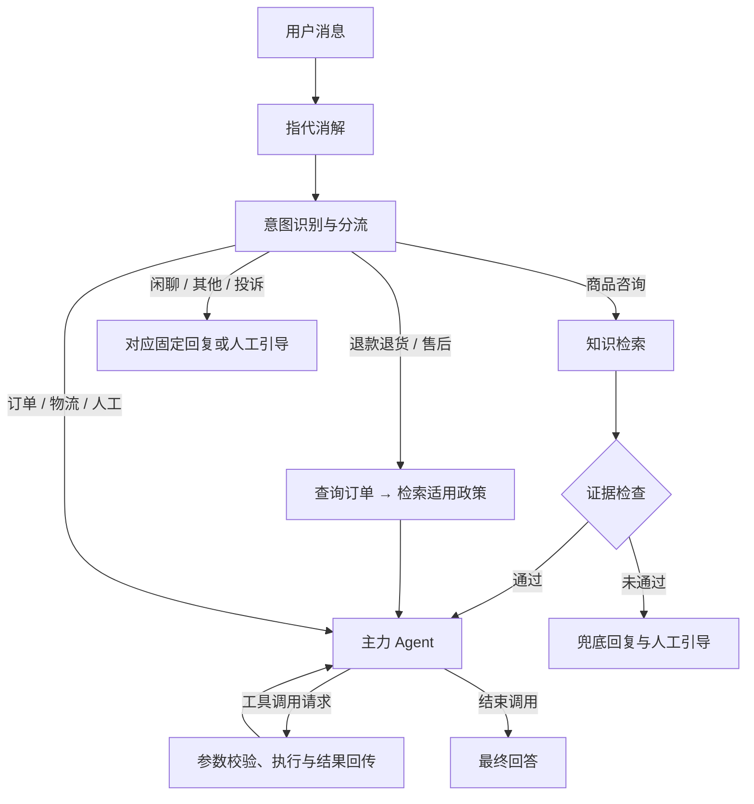

# AfterFlow — 电商智能客服 Agent

面向电商售后场景的智能客服应用，基于 **FastAPI + LangGraph** 构建，以确定性 Workflow 编排关键业务步骤，结合 Agent 工具调用完成订单查询、物流查询、政策问答与售后申请登记。

项目包含聊天前端、业务接口、RAG 知识库、MCP 工具服务，以及评估、可观测和问题回流管理页面。

## 核心能力

| 能力 | 实现方式 |
| --- | --- |
| 多轮对话与意图分流 | 指代消解后识别九类意图，映射到五条处理路径 |
| 售后政策问答 | 文档切分、BGE-M3 向量召回、BM25 关键词召回、RRF 融合与重排 |
| 订单与物流查询 | 通过工具取得业务数据，再由模型组织回答 |
| 退款与售后处理 | 固定执行订单查询和政策检索，支持订单选择、申请登记与中断续跑 |
| 工单创建 | 模型提出调用请求，程序校验参数并展示预览，用户确认后执行 |
| 对话上下文管理 | 滑动窗口、Token 预算、异步摘要与 LangGraph checkpoint |
| 问题回流 | 汇集低置信度问题、用户反馈与自检结果，经标准化、查重和人工审核补充知识 |
| 可观测与评估 | 记录工具调用、处理路径、Token 用量与检索结果，支持对照评估和置信度校准 |

## 架构设计

### Workflow 与 Agent 协同

Workflow 负责固定关键步骤，Agent 在给定上下文与工具范围内决定后续调用，并结合工具结果回答。



知识问答路径在生成前检查证据质量；退款售后路径先取得订单与政策。Agent 循环受最大步数限制，写入类操作需要经过程序控制的确认流程。

### RAG 检索链路

```text
离线：政策文档 → 结构化切分 → MySQL 保存知识块 → Embedding → Milvus
在线：消解后的问题 → 查询标准化与扩展 → 向量 / BM25 召回
    → RRF 融合 → Reranker 精排 → 证据整理与校验 → 模型生成带引用回答
```

- 检索优先使用指代消解后的完整问题，缺失时回退到用户原话。
- 标准问题用于向量检索和精排，同义词扩展用于 BM25 通道。
- 支持 `vector`、`bm25`、`hybrid`、`hybrid_rerank` 四种策略，便于离线比较。
- 知识问答的证据打分结合最强证据、有效证据数量、分数差和关键条款命中情况；阈值通过评估校准。

### 工具执行与状态管理

- 内置工具与 MCP 工具统一注册，经执行引擎完成参数校验、权限门控、超时处理、结果格式化和审计。
- 只读工具可针对暂时性故障重试；写入类工具采用不同的执行策略，避免盲目重试造成重复操作。
- LangGraph checkpoint 保存图执行状态，支持订单选择和工单确认后的恢复执行。
- 业务库保存会话、消息、工单、知识块及问题回流记录；SQLite 保存本地 checkpoint。

## 技术栈

| 层次 | 技术 |
| --- | --- |
| 接口与前端 | Python 3.12+、FastAPI、Pydantic、原生 HTML / CSS / JavaScript、SSE |
| Agent 编排 | LangChain、LangGraph、原生工具调用、MCP |
| 知识检索 | BGE-M3、Milvus、BM25、RRF、BGE-Reranker |
| 数据与状态 | MySQL、SQLAlchemy Async、SQLite checkpoint |
| 可观测 | 应用日志、工具审计、Langfuse（可选） |
| 主题分类扩展 | RoBERTa 多标签分类、PyTorch、ONNX Runtime（可选） |
| 环境管理 | uv、Docker Compose、pytest |

聊天模型、Embedding 和 Reranker 分别配置上游接口。默认检索模型为 `BAAI/bge-m3` 与 `BAAI/bge-reranker-v2-m3`，可以通过配置切换兼容的服务。

## 快速开始

### 1. 准备环境

需要 Python 3.12+、uv、Docker Compose 和 make。先启动 Docker Desktop、OrbStack 或其他可用的 Docker 运行环境。

在项目根目录安装依赖：

```bash
uv sync
```

### 2. 配置模型接口

首次运行时复制配置模板；已有 `.env` 时保留原配置：

```bash
cp -n .env.example .env
```

编辑 `.env`，配置以下字段：

| 配置项 | 用途 |
| --- | --- |
| `CHAT_BASE_URL` | 聊天模型接口地址 |
| `CHAT_MODEL` | 上游支持的真实模型名称 |
| `CHAT_API_KEY` | 聊天模型密钥 |
| `EMBED_API_KEY` | Embedding 服务密钥 |
| `RERANK_API_KEY` | Reranker 服务密钥 |

Embedding 与 Reranker 默认使用硅基流动接口。更换服务商时，同时配置 `EMBED_BASE_URL`、`RERANK_BASE_URL`，并核对对应模型和接口兼容性。`.env` 已加入忽略规则，仓库只保留配置模板。

### 3. 启动依赖并准备数据

```bash
docker compose up -d --wait
make seed
make kb-build
make kb-vectorize
```

Compose 启动 MySQL、etcd、MinIO 和 Milvus。MySQL 的 `sql/` 初始化脚本在首次创建数据目录时执行。`kb-build` 将知识文档切块落库，`kb-vectorize` 调用 Embedding 接口写入向量库。

### 4. 启动应用

```bash
make dev
```

该命令会检查依赖、启动两台业务 MCP Server，再启动 FastAPI 应用。打开 <http://localhost:8000> 即可使用。

可尝试：

- `订单 1001 的物流到哪了？`
- `普通商品无理由退货，退回运费由谁承担？`
- 先问 `我想了解定制商品的退货政策`，再问 `那它如果有质量问题呢？`
- `请帮我创建一张咨询工单，了解自动饮水机的保修范围。`

后续再次启动时，启动 Docker 运行环境并执行 `make dev` 即可；已有知识库无需每次重新构建。

## 页面入口

| 路径 | 功能 |
| --- | --- |
| `/` | 智能客服聊天 |
| `/admin` | 后台管理入口 |
| `/kb` | 知识录入与检索自测 |
| `/rag-eval` | 检索策略对照评估 |
| `/review` | 问题回流与人工复核 |
| `/observability` | 观测、成本与置信度校准 |
| `/topics` | 问题主题分布 |
| `/acceptance` | 主题分类器评估与产物检查 |
| `/docs` | API 文档 |

主应用端口为 `8000`，物流与售后 MCP 服务端口为 `8101`、`8102`，Milvus 为 `19530`。可选 Langfuse 使用 `3000`，主题分类推理服务使用 `8110`。

## 测试与评估

| 命令 | 用途 |
| --- | --- |
| `uv run pytest tests/test_static.py -q` | 检查聊天页、后台页面和静态资源 |
| `make test` | 执行现有测试集 |
| `make eval-retrieval` | 检索召回评估 |
| `make eval-rag` | 比较四种检索策略及回答质量 |
| `make calibrate-confidence` | 扫描证据阈值，观察误放与误拦 |
| `make eval-flywheel` | 评估知识回流后的系统表现 |
| `make help` | 查看更多命令及前置条件 |

数据库相关测试使用 `TEST_DATABASE_URL` 指定的独立测试库，并会重建测试表。检索与端到端评估需要依赖服务、已构建的知识库和有效模型接口；部分命令会产生 API 调用费用。

评估时分别检查检索证据、答案要点、回答忠实度、拒答行为和运行耗时。对照实验应固定问题集、标注标准和参数，避免将不同条件下的结果直接比较。

## 可选扩展

- **Langfuse**：`make langfuse-up` 启动本地观测栈，配置 `.env.example` 中的三个 `LANGFUSE_*` 字段后启用回调。
- **主题分类**：通过 `uv sync --group ml` 安装训练与推理依赖，使用 `make ch10-train`、`make ch10-eval`、`make ch10-export` 等命令训练、评估和导出模型；需先准备对应数据集。

## 目录结构

```text
app/
├── api/          # HTTP 与 SSE 接口
├── graph/        # 状态定义、节点、路由与图运行入口
├── core/         # 模型调用、检索、指代消解、摘要、置信度与观测
├── kb/           # 文档切分、知识落库、向量化与去重
├── tools/        # 工具定义、注册中心、MCP 客户端与执行引擎
├── db/           # 数据模型与仓储
├── schemas/      # 请求与响应结构
└── static/       # 聊天页和后台管理页面
mcp_servers/     # 物流与售后工具服务
data/kb/         # 示例知识文档
scripts/         # 建库、评估、知识回流与模型训练脚本
sql/             # 数据库初始化与迁移脚本
tests/           # 测试用例
docs/            # 设计与实现记录
```

## 运行范围

订单与物流采用模拟业务数据；退款功能登记售后申请，未接入实际支付退款。当前用户标识用于本地演示，不等同于完整的生产认证系统。对外运行前需要补齐认证、访问控制和部署配置。

为兼容已有本地数据，数据库、容器和数据卷保留原有内部标识。源码来源信息集中记录于 [NOTICE.md](NOTICE.md)。
